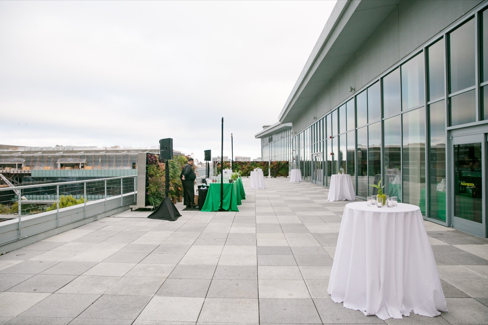

_사진: [TechCrunch](https://commons.wikimedia.org/wiki/File:TechCrunch_Disrupt_San_Francisco_2018_-_day_1_(44485273502).jpg), [CC BY 2.0](https://creativecommons.org/licenses/by/2.0) — 2018년 Disrupt 현장 자료 사진_

**TechCrunch Disrupt 2026**에 **리얼 월드 AI(Real World AI)** 스테이지가 새로 생겼습니다.
디지털과 물리 세계가 만나는 지점, 그러니까 **자율 하드웨어가 실제 공간에 들어가는 문제**만 따로 다루는 무대입니다.

- **일정**: 2026년 10월 13~15일
- **장소**: 샌프란시스코 모스콘 웨스트
- **규모**: 스타트업·테크·VC 리더 1만 명 이상

<figure class="sketch">
<svg viewBox="0 0 720 330" role="img" aria-label="리얼 월드 AI 스테이지의 세 세션(데이터 격차, 실패와 안전, 엣지)이 소프트웨어 에이전트의 RAG, 되돌릴 수 없는 동작, 노드별 모델 선택 문제와 각각 대응되는 그림">
  <defs>
    <marker id="disr-m1" viewBox="0 0 10 10" refX="9" refY="5"
            markerWidth="7" markerHeight="7" orient="auto-start-reverse">
      <path d="M0,0 L10,5 L0,10 z" class="sk-fill-accent"/>
    </marker>
  </defs>
  <text x="0" y="14" class="sk-title">① 물리 AI 세션 ↔ 소프트웨어 에이전트의 같은 문제</text>

  <text x="110" y="52" text-anchor="middle" class="sk-label">Real World AI 세션</text>
  <text x="610" y="52" text-anchor="middle" class="sk-label">업무 에이전트</text>

  <rect x="8" y="68" width="204" height="62" rx="8" class="sk-box"/>
  <text x="110" y="93" text-anchor="middle" class="sk-label">Robots' ChatGPT Moment</text>
  <text x="110" y="113" text-anchor="middle" class="sk-sub">범용 로봇 지능을 막는 데이터 격차</text>

  <rect x="8" y="148" width="204" height="62" rx="8" class="sk-box"/>
  <text x="110" y="173" text-anchor="middle" class="sk-label">AI Failure &amp; Safety</text>
  <text x="110" y="193" text-anchor="middle" class="sk-sub">실패 대가가 큰 환경의 자율 시스템</text>

  <rect x="8" y="228" width="204" height="62" rx="8" class="sk-box"/>
  <text x="110" y="253" text-anchor="middle" class="sk-label">Edge AI Deployment</text>
  <text x="110" y="273" text-anchor="middle" class="sk-sub">클라우드 연결이 없는 곳에서 실행</text>

  <rect x="408" y="68" width="304" height="62" rx="8" class="sk-box-accent"/>
  <text x="560" y="93" text-anchor="middle" class="sk-label">우리 회사 업무 데이터 부족</text>
  <text x="560" y="113" text-anchor="middle" class="sk-sub">RAG로 이 격차를 메운다</text>

  <rect x="408" y="148" width="304" height="62" rx="8" class="sk-box-accent"/>
  <text x="560" y="173" text-anchor="middle" class="sk-label">되돌릴 수 없는 동작을 자율에 맡김</text>
  <text x="560" y="193" text-anchor="middle" class="sk-sub">잘못된 메일 발송, 데이터 삭제</text>

  <rect x="408" y="228" width="304" height="62" rx="8" class="sk-box-accent"/>
  <text x="560" y="253" text-anchor="middle" class="sk-label">노드마다 모델 고르기</text>
  <text x="560" y="273" text-anchor="middle" class="sk-sub">로컬 판단 vs 위로 올릴 판단</text>

  <path d="M214,99 L406,99" class="sk-line-accent" marker-end="url(#disr-m1)"/>
  <path d="M214,179 L406,179" class="sk-line-accent" marker-end="url(#disr-m1)"/>
  <path d="M214,259 L406,259" class="sk-line-accent" marker-end="url(#disr-m1)"/>

  <text x="360" y="320" text-anchor="middle" class="sk-sub">공통 질문: 자율성을 어디까지 줄 것인가</text>
</svg>
<figcaption>물리 AI라고 따로 노는 문제가 아니라, 소프트웨어 에이전트와 같은 "자율성을 어디까지 줄 것인가"라는 질문을 다른 무대에서 하고 있다.</figcaption>
</figure>

## 라인업

| 이름 | 직함 | 소속 |
|---|---|---|
| Les Karpas | Head of Physical AI | **Nvidia** |
| Nate Michael | CTO | **Shield AI** |
| Dr. Ali Agha | CEO & Founder | **FieldAI** |
| Boris Sofman | Co-founder & CEO | Bedrock Robotics |
| Ben Lamm | CEO | Colossal Biosciences |
| Michelle Lee | CEO & Founder | Medra |
| John Mackey | CEO, Co-founder | MBRYONICS |
| Adrian Macneil | CEO | Foxglove |
| Aidan Madigan-Curtis | Partner | Eclipse Ventures |

공공장소, 국방 시스템, 가정, 그리고 **멸종 생물 복원**까지 범위가 꽤 넓습니다.

## 세션 다섯 개

1. **Robots' ChatGPT Moment** — 범용 로봇 지능을 막고 있는 **데이터 격차**
2. **AI Failure & Safety** — 실패 대가가 큰 환경에 자율 시스템을 배포하는 문제
3. **De-extinction** — AI와 생명공학으로 멸종 종을 되살리기
4. **Edge AI Deployment** — **클라우드 연결이 없는 곳**에서 AI를 돌리기
5. **Prototype to Production** — 딥테크를 실험실에서 시장으로

## 소프트웨어 에이전트 쪽에서 볼 이유

솔직히 로봇은 제 영역이 아닙니다. 그런데 세션 목록을 보다 보니
**세 개는 제가 지금 겪고 있는 문제와 같은 것**이더군요.

**① 데이터 격차 (Robots' ChatGPT Moment)**
로봇이 범용 지능을 못 갖는 이유가 학습 데이터라는 진단인데,
사내 업무 에이전트도 똑같습니다. 모델은 충분히 똑똑한데
**우리 회사가 일을 어떻게 하는지에 대한 데이터**가 없어서 못 씁니다.
RAG를 붙이는 이유가 결국 이 격차를 메우는 것이고요.

**② 실패와 안전 (AI Failure & Safety)**
"stakes are high"한 환경에 자율 시스템을 넣는 문제.
로봇은 사람을 다치게 할 수 있고, 업무 에이전트는 잘못된 메일을 보내거나 데이터를 지웁니다.
크기는 달라도 **되돌릴 수 없는 동작을 자율에 맡기는 설계**라는 점은 같습니다.
[불투명 반복 이야기](/posts/openai-astra-opaque-recurrence/)와도 맞닿아 있습니다.

**③ 엣지 (Edge AI Deployment)**
클라우드 없이 돌린다는 건, 큰 모델을 못 쓴다는 뜻입니다.
작은 모델로 어디까지 되는지, 어떤 판단을 로컬에 남기고 어떤 걸 올려보낼지 —
비용 최적화하느라 노드마다 모델을 고르는 것과 사실 같은 고민입니다.

물리 AI라고 따로 노는 게 아니라, **자율성을 어디까지 줄 것인가**라는
같은 질문을 다른 무대에서 하고 있는 셈입니다.

Nvidia에 "Head of Physical AI"라는 직함이 있다는 것도
이 분야가 실험이 아니라 조직으로 굳어졌다는 신호로 읽힙니다.

---

## 참고

- [TechCrunch Disrupt 2026's new Real World AI stage features Nvidia, robots, and extinct animals](https://techcrunch.com/2026/09/02/techcrunch-disrupt-2026s-new-real-world-ai-stage-features-nvidia-robots-and-extinct-animals/) — TechCrunch, 2026-09-02

이 글은 위 기사의 내용을 정리하고 재구성한 것입니다. 마지막 절의 해석은 제 의견입니다.
